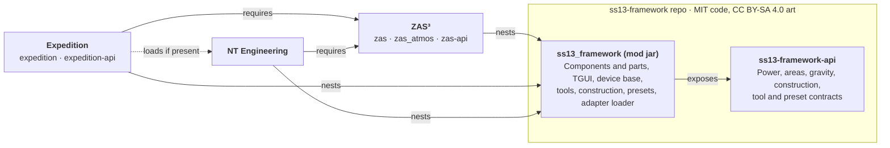
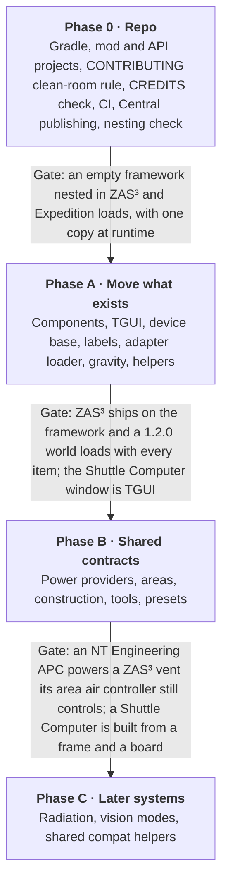

# SS13 Framework — Design Proposal

As of 2026-11-23. Based on [ZAS³](https://github.com/west3436/zas-cubed) at `1cce611d`, [Expedition](https://github.com/west3436/expedition) at `9f643a7` (#99) and the [NT Engineering plan](https://github.com/west3436/nt-engineering/blob/bfe651c/docs/design-proposal.md) of 2026-11-13.

## Summary

SS13 Framework holds the parts that ZAS³, Expedition and NT Engineering would otherwise each build or copy: SS13 crafting components and stock parts, the TGUI window kit, a device base, tools, power, areas, gravity and the Normal/Hardcore switch. It is a mod plus an API jar. None of the three needs a player to install it: each nests it by jar-in-jar.

- **License:** MIT code, CC BY-SA 4.0 art, clean-room against vgstation13, the same rules as ZAS³ and NT Engineering.
- **Packaging:** an `ss13_framework` mod jar and an `ss13-framework-api` jar on Maven Central. Both depend only on Minecraft and NeoForge, never on any of the three mods.
- **What moves in first:** code ZAS³ already has that isn't about gas: components, TGUI, the device base, the adapter loader. Expedition's gravity contract moves too, before `expedition-api` is first released.
- **What is designed here next:** contracts at least two mods need: power providers, areas, frame-and-board construction, tools, presets.
- **What stays out:** gas, zones, pipes and breathing (ZAS³); ship moving, planets and flight (Expedition); the grid, APCs, SMES and engines (NT Engineering). `zas-api` stays gas-only.
- **First milestone:** ZAS³ ships on the framework with its components and TGUI moved, and worlds saved on 1.2.0 load with every item intact.

## Why now

| Finding | Where | Consequence |
| --- | --- | --- |
| ZAS³ registers 19 SS13 parts as plain crafting items: `machine_frame`, `circuit_board`, `cable_coil`, three capacitor tiers, `micro_laser`, `scanning_module`, `micro_manipulator` and others | `zas-atmos/.../registry/AtmosItems.java:292-330` | NT Engineering plans the same items as working, tiered parts. Without one owner there are two `machine_frame` items. |
| Expedition #50 wants the Shuttle Computer and drives built from frames, boards and parts | [expedition#50](https://github.com/west3436/expedition/issues/50) | All three mods use the parts, not just NT Engineering. |
| `zas_atmos` compiles against `zas-api` only (CONT-095), and `zas-api` may depend on nothing but Minecraft and NeoForge | `zas-atmos/build.gradle`, `zas-api/build.gradle` | Shared code can't live in `zas` or `zas-api`. The version check is already copied three times inside ZAS³ (`VersionGate`, `PonderGate`, `JadeGate`). |
| The TGUI kit is internal to `zas_atmos` | `zas-atmos/.../client/tgui/` | Expedition's `ShuttleComputerScreen` is a hand-drawn vanilla screen instead (373 LOC). |
| `expedition-api` is unreleased at 0.1.0 and holds the gravity API that NT Engineering's gravity generator is meant to bundle | `expedition-api/.../planet/PlanetGravity.java`, [expedition#16](https://github.com/west3436/expedition/issues/16) | Moving the gravity contract costs nothing now and is a breaking change after the first release. |
| NT Engineering's plan asks ZAS³ for an APC power hook, a radiation hazard and shared areas | NT plan, "What ZAS³ needs to provide" | None of these is about gas. They belong in a shared mod, not in `zas-api`. |

## Packaging

Arrows point from a module to what it depends on; dashed means optional.

- **Nested, not installed.** Each mod nests the framework jar with a version range, as ZAS³ nests `zas-api` today. NeoForge loads the newest nested copy. "ZAS³ is the only required mod" (expedition#50) still holds.
- **The framework depends on none of the three.** It has no gas in it. A mod that wants gas reads `zas-api`.
- **`zas-api` stays gas-only.** `ClientSounds`, `DisplayUnits` and `Relocations.shownAt` stay where they are: moving them is a major API break, and Expedition uses `Relocations`.
- **CONT-095 widens** to "`zas_atmos` compiles against `zas-api` and the framework, never `zas` internals".
- **Items that move keep working.** ZAS³ registers each old id as an alias of the new one with `DeferredRegister#addAlias`, so worlds and recipes saved on 1.x keep their items. A GameTest loads a 1.2.0 save.
- **Versioning.** The mod stays 0.x until all three mods use it. The API follows `zas-api`'s rules from 1.0: semver, japicmp against the last release, `checkApiPackages`, `checkApiDependencies` and strict javadoc.

## Contents

The phases are ordered by who is waiting. Phase A moves code that exists. Phase B designs contracts NT Engineering's Phase 1 needs. Phase C follows NT Engineering's Phases 2 and 3.

### Phase A: move what exists

| Item | Comes from | Size | Used by |
| --- | --- | --- | --- |
| Crafting components and stock parts: the 19 items, their recipes, textures, CREDITS entries and new part tags ([#4](https://github.com/west3436/ss13-framework/issues/4)) | ZAS³ `AtmosItems` | items only | All three |
| TGUI kit: `Ui`, `TguiScreen`, `TguiWindow`, `TitleLabel`, `Readout`, the DejaVu fonts and `generateTguiFonts`, `WalkingInput`, the generic parts of `DeviceParts` ([#5](https://github.com/west3436/ss13-framework/issues/5)) | ZAS³ `atmos/client/tgui/`, `atmos/client/` | ~1.6k LOC | All three |
| Device base: `DeviceSchedule`, `DeviceTicker`, tick constants, `LoadedBlocks`, `RedstoneControl`, `Comparators`, `ItemData` and `DeviceData` save migration, `BlockTurns`, `WallPanelBlock`, activity levels and loop sounds ([#6](https://github.com/west3436/ss13-framework/issues/6)) | ZAS³ `atmos/device/`, `atmos/airlock/WallPanelBlock` | ~3k LOC | `AtmosDevice` extends it; every NT machine and Expedition console |
| Labels, with multi-block lookups behind an interface instead of named airlock and firelock classes ([#6](https://github.com/west3436/ss13-framework/issues/6)) | ZAS³ `atmos/label/` | ~0.4k LOC | All three |
| Adapter loader: one `Adapters` table and one `VersionGate` ([#7](https://github.com/west3436/ss13-framework/issues/7)) | ZAS³ `zas/compat/` | ~0.4k LOC | Every compat adapter in all three |
| Gravity contract: `Gravity.at(level, pos)` composed from providers, and the code that applies it to entities ([#8](https://github.com/west3436/ss13-framework/issues/8)) | Expedition `PlanetGravity`, `PlanetGravityEvents`, `EntityGravityMixin` | ~0.3k LOC | Expedition planets and deck gravity (expedition#83); NT Engineering's gravity generator |
| Small helpers: `DatapackErrors`, `ClaimCheck`, `TickBudget` ([#9](https://github.com/west3436/ss13-framework/issues/9)) | ZAS³ `zas/data/`; Expedition `mover/` | ~0.4k LOC | Datapack loading in all three; NT Engineering's RCD and RPD |

### Phase B: shared contracts, built with NT Engineering Phase 1

| Item | What it is | Why it is shared |
| --- | --- | --- |
| Power provider contract ([#10](https://github.com/west3436/ss13-framework/issues/10)) | `PoweredDevice`, the `DevicePower` lease, `PowerFeed`, `EnergyStore`, `WorkToFe` and batteries move as they are. New: a `PowerProvider` that claims devices, and APC-style channels (equipment, lighting, environment). | ZAS³'s area air controller becomes one provider and NT Engineering's APC another, which takes over where both exist while the controller keeps monitoring and control. Expedition's electric and Bluespace drives (expedition#38, #40) draw from it. |
| Areas ([#11](https://github.com/west3436/ss13-framework/issues/11)) | A named region, like SS13's `/area`: `Areas.at(level, pos)`, providers, change events, carried along when blocks move. | APCs, lighting and power channels; Expedition's ship boxes. ZAS³ zones stay about gas. |
| Machine construction ([#12](https://github.com/west3436/ss13-framework/issues/12)) | Machine and computer frames, wiring, a board that names its machine and parts, part slots, and four part tiers that set a machine's stats. | Every NT machine; Expedition's Shuttle Computer and drives (expedition#50). A plain crafting recipe stays for every machine. |
| Tools ([#13](https://github.com/west3436/ss13-framework/issues/13)) | Multitool with a `Linkable` buffer, wrench with `Wrenchable`, crowbar with `Pryable`, plus screwdriver, wirecutters and welder; `c:tools/*` tags. ZAS³'s tool items move with aliases. | The multitool and wrench today are hard-coded lists of ZAS³ classes. NT Engineering's plan already reuses them instead of making its own. |
| Normal/Hardcore switch ([#14](https://github.com/west3436/ss13-framework/issues/14)) | The `PresetOption` mechanism, the per-world copy and the preset command. Each mod registers its own options. | ZAS³'s 15 options, Expedition's Hardcore fuel burn (expedition#53), NT Engineering's cable burnout and singularity damage. |
| Station walls and reinforced glass (to decide) ([#15](https://github.com/west3436/ss13-framework/issues/15)) | ZAS³'s walls, glass and grilles with their connected textures. | RCD, welding and Expedition hulls all touch them. Pipes pass through them sealed, so the seal rule would need an interface. |

### Phase C: with NT Engineering Phases 2 and 3

| Item | What it is | Used by |
| --- | --- | --- |
| Radiation ([#16](https://github.com/west3436/ss13-framework/issues/16)) | A hazard that doesn't come from gas: sources, dose per entity, protection on armour from a data map, a Geiger counter, suit encumbrance. | NT Engineering's engines; ZAS³ suits get protection values and radioactive gases can add dose. |
| Vision modes ([#17](https://github.com/west3436/ss13-framework/issues/17)) | Meson and T-ray views. Mods register what shows: ZAS³ its pipes, NT Engineering its cables. Builds on ZAS³'s `zas:shows_hud` tag pattern. | NT Engineering's goggles and scanner. |
| Shared compat helpers ([#18](https://github.com/west3436/ss13-framework/issues/18)) | Ponder scene helpers (`Build`, `Hand`, `Say`, `Stage`) and the Ponder addon, Jade's readout model, the JEI/EMI layout shared by both viewers, CC:Tweaked's `Lua` helper. | Every Ponder scene, tooltip and peripheral in all three. |

### Tooling, at any time ([#19](https://github.com/west3436/ss13-framework/issues/19))

Not part of the mod jar. Expedition's build and CI are near-copies of ZAS³'s, and NT Engineering would copy them a third time.

- A Gradle convention plugin: API publishing to Central, japicmp, the API checks, Spotless.
- A test kit for GameTests: `TestPlayers`, `ListeningPlayer`, `SoundLog`, `FaultLog`.
- `check_credits.py` and `PlayerTextScan`.
- Reusable GitHub workflows (`workflow_call`) for build, GameTests, the adapter matrix and releases.

## What stays where it is

| Mod | Keeps |
| --- | --- |
| ZAS³ | The engine, zones, pipes, the breathing, hazard and HUD system, suits and tanks, how area air controllers find their devices, the TEG and turbine, airlock and firelock logic, CC:Tweaked peripherals, `/zas` |
| Expedition | The ship mover (3.3k LOC, only Expedition needs it), planets, Space and transit, drives, flight |
| NT Engineering | Cables and the grid, APCs, SMES, lighting, every engine, the autolathe and circuit printer, the boards for its own machines |

## What each mod changes

**ZAS³**

1. Nest the framework and widen CONT-095.
2. Move the components, TGUI, device base, labels, adapter loader and `DatapackErrors`, with aliases for moved ids.
3. Make the area air controller a power provider.
4. Make the multitool, wrench and crowbar framework tools with ZAS³ behaviour behind the interfaces.
5. Register its 15 preset options with the framework switch.
6. Later: radiation protection on suits, pipes in T-ray view, shared compat helpers.

**Expedition**

1. Nest the framework.
2. Move the gravity contract out before `expedition-api` 0.1.0 is released.
3. Rebuild the Shuttle Computer window on TGUI.
4. Move `ClaimCheck` and `TickBudget`.
5. Use the adapter loader for `compat-cc` (expedition#36), the power contract for the electric and Bluespace drives, and the preset switch for Hardcore fuel burn.
6. With construction in the framework, the Shuttle Computer can be built from a frame and a board without NT Engineering. expedition#50 narrows to APC power, the gravity generator and autolathe prints.

**NT Engineering**

1. Build against ZAS³ and the framework.
2. `nte-api`'s purpose (power, gravity and machine-part interfaces) moves into the framework API. It shrinks to grid-specific reads, or goes away.
3. Its "what ZAS³ needs to provide" list becomes framework work: the APC hook is the power contract, radiation is Phase C, shared areas are Phase B.
4. ZAS³ has shipped the TEG and the gas turbine with FE output (zas-cubed#530, #531). NT Engineering connects them to its grid instead of building its own.

## Plan conflicts found

1. **TEG and turbine.** The NT plan lists both as NT Engineering content. ZAS³ shipped them on 2026-11-18 and 2026-11-23.
2. **Cable.** ZAS³ removed its power cable on purpose (D-68) and keeps `cable_coil` only as an ingredient. NT Engineering's coil places cable. If the framework owns the item, NT Engineering registers the placing.
3. **Batteries and power cells.** ZAS³ has battery tiers and a recharger; NT Engineering plans power cells. One item set, in the framework.
4. **Expedition's GameTests use ZAS³ internals** (`ZasContentMoveTests`: vents, pipe networks, controllers). Framework and API surface lets them stop.

## Roadmap

Phase B runs in step with NT Engineering's Phase 1, since that is where its contracts are first used. Phase C runs with NT Engineering's Phases 2 and 3. Tooling can start at any point.

Each phase is a [milestone](https://github.com/west3436/ss13-framework/milestones); Phase 0 is [#2](https://github.com/west3436/ss13-framework/issues/2) and [#3](https://github.com/west3436/ss13-framework/issues/3).

## Decisions (proposed)

| Topic | Proposal |
| --- | --- |
| Packaging | A mod jar and an API jar, nested by all three mods; players never install the framework on its own. |
| Dependencies | The framework depends only on Minecraft and NeoForge. `zas-api` stays gas-only and keeps every type it has. |
| Moved ids | Registry aliases from `zas_atmos:` ids, proven by a GameTest on a 1.2.0 save. |
| ZAS³ release | The next minor release, since the API doesn't change and aliases keep worlds intact. |
| Construction | In the framework, so Expedition and ZAS³ machines can use frames without NT Engineering. |
| `nte-api` | Its interfaces move into the framework API. |

## Open questions

1. Mod id and package. Proposed: mod id `ss13_framework`, Maven `io.github.west3436:ss13-framework-api`, package `io.github.west3436.ss13`.
2. Construction in the framework or in NT Engineering? This proposal says the framework.
3. With construction in the framework, should Expedition's machines need frames even without NT Engineering, or keep a plain recipe as well?
4. Do station walls and glass move?
5. Does `nte-api` go away entirely, or keep grid-specific reads?

## Sources

- [ZAS³](https://github.com/west3436/zas-cubed): `AtmosItems.java`, `atmos/client/tgui/`, `atmos/device/`, `atmos/power/`, `atmos/tool/`, `zas/compat/Adapters.java`, `zas/config/PresetOption.java`, `zas-api/build.gradle`; [#530](https://github.com/west3436/zas-cubed/pull/530), [#531](https://github.com/west3436/zas-cubed/pull/531)
- [Expedition](https://github.com/west3436/expedition): `expedition-api/.../planet/PlanetGravity.java`, `client/ShuttleComputerScreen.java`, `mover/ClaimCheck.java`, `mover/TickBudget.java`; issues [#16](https://github.com/west3436/expedition/issues/16), [#36](https://github.com/west3436/expedition/issues/36), [#38](https://github.com/west3436/expedition/issues/38), [#40](https://github.com/west3436/expedition/issues/40), [#50](https://github.com/west3436/expedition/issues/50), [#53](https://github.com/west3436/expedition/issues/53), [#83](https://github.com/west3436/expedition/issues/83)
- [NT Engineering design proposal](https://github.com/west3436/nt-engineering/blob/bfe651c/docs/design-proposal.md)
- NeoForge 21.1 `DeferredRegister#addAlias`
